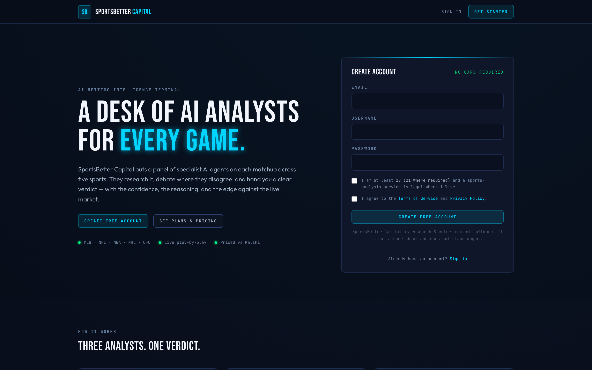
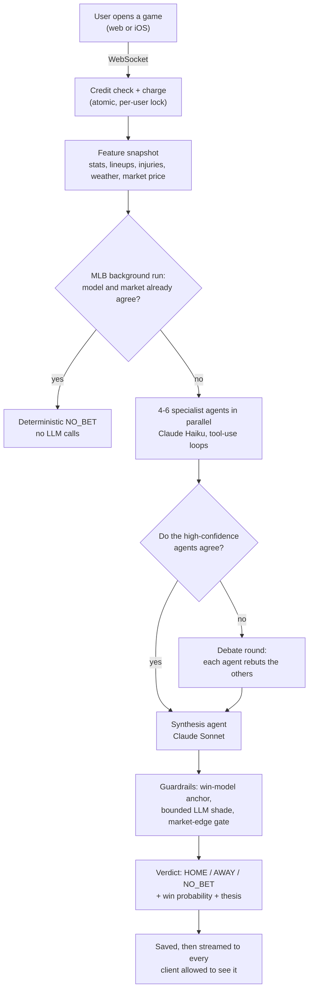
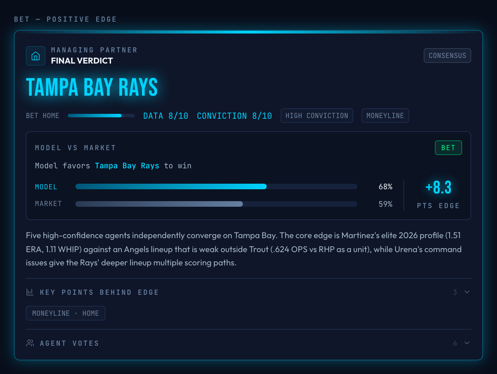
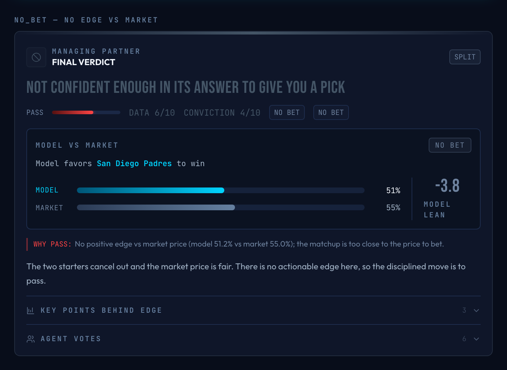
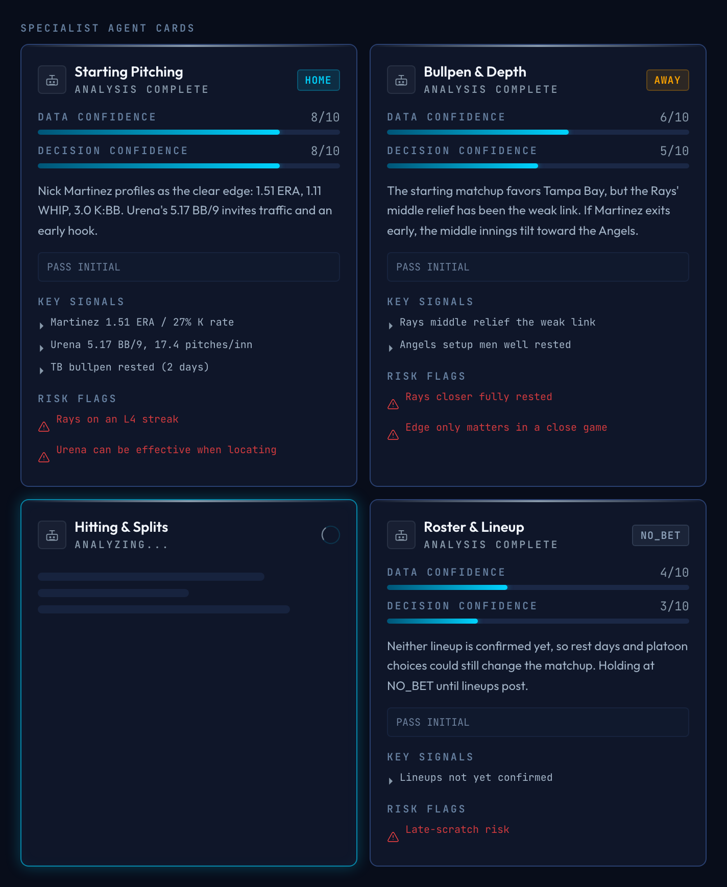

# Sports-Better

**An AI sports analysis platform where a team of Claude agents researches a game, argues about it, and hands back a pick with a confidence score and a written thesis.**

Live at **[sports-better.com](https://sports-better.com)** as a paid subscription product. Covers MLB, NBA, NFL, NHL and UFC.

> [!NOTE]
> This is a showcase repository. The production code is private because it runs a live paid service. This repo has the write-up, architecture and screenshots instead of source.

  

## What it does

You pick a game. Sports-Better then:

1. **Builds a data snapshot** from free public sources (ESPN, MLB Stats API, Baseball Savant, Open-Meteo) plus the live Kalshi prediction-market price.
2. **Runs 4 to 6 specialist agents for that sport in parallel.** An MLB game gets Starting Pitching, Bullpen, Hitting & Splits, Roster & Lineups, Park & Weather and Team Context. Each agent decides for itself which data tools to call, then reports HOME, AWAY or NO_BET with two scores: how complete its data was, and how strong it thinks the edge is.
3. **Holds a debate if the confident agents disagree.** Each agent reads the others' cases and either holds its position or changes it, with a stated reason.
4. **Synthesizes a verdict.** A final agent weighs the reports and writes the pick, a win probability, an edge rating, key evidence and a thesis.
5. **Checks the verdict with deterministic code.** A per-sport win-probability model anchors the number, the LLM can only nudge it by a few points, and a pick that doesn't beat the de-vigged market price becomes NO_BET.

Everything streams live over WebSockets to the web app and a native iOS app, so you can watch the agents work as it happens.

## How an analysis runs

More detail: [Architecture](docs/ARCHITECTURE.md) · [The agents and the debate](docs/AGENTS.md)

## Screenshots

<table>
  <tr>
    <td width="50%"></td>
    <td width="50%"></td>
  </tr>
  <tr>
    <td>A pick: the model's 68% beats the market's 59%, an 8.3-point edge.</td>
    <td>A pass: the model doesn't beat the market price, so the answer is NO_BET.</td>
  </tr>
</table>

  
   
  <em>Specialist agents mid-run. Each card shows the agent's pick, both confidence scores, key signals and risk flags.</em>

The verdict and agent cards are the production UI components, shown with sample data.

## By the numbers

| | |
|---|---|
| Timeline | May 2026 to now, built solo, after several earlier prototypes |
| Backend | ~28K lines of Python (FastAPI, asyncio, SQLite) |
| Web | ~20K lines of TypeScript/React across 17 pages |
| iOS | ~13K lines of Swift, a native SwiftUI client |
| Tests | 526 automated tests in 66 files; CI runs ruff, mypy, unit tests, ESLint and a full build |
| Agents | 25 sport-specific specialists across 5 leagues, plus a synthesis agent |
| Usage | 1,300+ multi-agent analyses across 960+ games: 4,100+ LLM calls, 26M+ tokens |

## Tech stack

| Layer | What it uses |
|---|---|
| Backend | Python 3.12, FastAPI, WebSockets, asyncio, httpx, an in-process pub/sub event bus |
| AI | Anthropic Claude: Haiku 4.5 for specialist agents, Sonnet 4.6 for the final synthesis; tool use and prompt caching |
| Models | Deterministic per-sport win-probability models (MLB, NBA, NFL), de-vigged market pricing, fractional-Kelly stake sizing |
| Storage | SQLite (WAL) for the usage ledger and analysis history, JSON stores with atomic writes |
| Web | React 18, TypeScript, Vite, Tailwind; no router or state library |
| iOS | SwiftUI (iOS 17+), the same backend and live WebSocket feeds as the web app |
| Infra | Docker on a self-hosted homelab server, exposed only through a Cloudflare Tunnel; web app on Cloudflare Workers; GitHub Actions CI |
| Product | Stripe subscriptions and webhooks, Resend email, ntfy push notifications |
| Auth | Argon2id passwords, email verification, single-use tokens, session revocation, encrypted-at-rest user API keys |

## Engineering highlights

Each of these is written up as a short problem-and-fix case study in [ENGINEERING.md](docs/ENGINEERING.md).

- **No paying for agreement.** The debate round only runs when the high-confidence agents split, so a clear game costs far fewer model calls.
- **LLMs don't get to invent probabilities.** A deterministic model sets the win probability, the agents may shade it within a hard cap, and the result has to beat the de-vigged market price or the answer is NO_BET.
- **Cost control at every layer.** Cheap model for research, stronger model for synthesis, prompt caching inside tool loops, a free deterministic pre-screen for background MLB runs, and shared-cache replays that are invalidated when lineups, injuries or weather change. A full analysis costs about 10 to 25 cents.
- **One failing agent doesn't sink the run.** A rate-limited or malformed agent turns into a recorded NO_BET instead of throwing away the other agents' paid work.
- **Closing the tab doesn't kill the analysis.** The server keeps the run going, saves it, and lets the user come back to the finished result without paying again.
- **No double-spending credits.** Weekly credits come from a ledger, not a stored balance, and the check-then-charge step runs under a per-user lock to close a race between concurrent requests.
- **Correct Stripe webhooks.** Idempotent event handling, and a fix so an old subscription's late deletion event can't downgrade a user who just upgraded.
- **Honest calibration.** Brier score and log-loss against the market price, per-sport calibration watchdogs, and backtesting. The product doesn't claim to beat the market unless the numbers show it.
- **Self-hosted production.** A hardened container (non-root, no-new-privileges, memory and process limits) behind a Cloudflare Tunnel with no open inbound ports. See [SECURITY.md](docs/SECURITY.md).

## My role

I built Sports-Better on my own: the product, the architecture, the backend, the web and iOS clients, billing, and the homelab deployment it runs on. I built it with AI coding agents (Claude Code and Codex). I designed the system, split the work into tasks, reviewed and tested what the agents wrote, ran multi-agent code and security audits, and I run production.

Next, I plan to train a model of my own on the analysis data Sports-Better has collected.

## Disclaimer

Sports-Better is for research and education. It is not betting or financial advice. Users must be 18+ (21+ where required). Sports betting carries real risk, so check your local laws.

## License

All rights reserved. This repository is a portfolio showcase, not open source. See [LICENSE](LICENSE).
