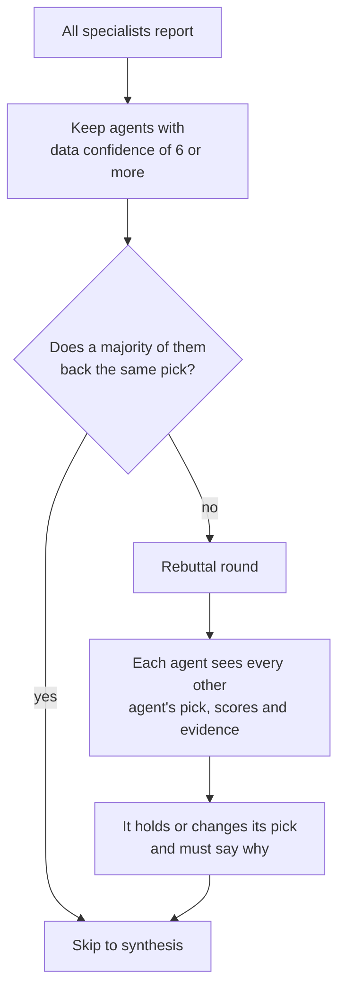

# The agents and the debate

Sports-Better treats a game the way a research team might: several specialists each look at one slice of the problem, argue when they disagree, and a lead makes the call. This page explains how that works. It describes the design and leaves out the prompts.

## The roster

Each league has its own suite of specialists. They all return the same structured report, so the debate and synthesis steps don't care which sport they're handling.

| League | Agents |
|---|---|
| **MLB** (6) | Starting Pitching · Bullpen & Pitching Depth · Hitting & Matchup Splits · Roster & Lineup Availability · Park & Run Environment · Team Context & Schedule |
| **NFL** (6) | Quarterback & Passing · Pass Rush & Defense · Rushing & Offensive Line · Injuries & Inactives · Weather & Venue · Team Context & Situational |
| **NBA** (4) | Offensive Efficiency · Defense & Matchup · Availability & Rotation · Rest, Schedule & Props |
| **NHL** (4) | Goaltending · Special Teams · Skater Availability · Team Form & Rest |
| **UFC** (5) | Striking · Grappling · Cardio & Durability · Matchup & Style · Recent Form & Camp |

There is also a set of three generalist agents (Team, Player, Lineup) that any league without its own suite falls back to.

## What one agent is

Each specialist is a Claude model with:

- **A role.** One domain, such as "bullpen workload and short-start risk".
- **Its own tools.** Functions that wrap the data sources: probable pitchers, handedness splits, park factors, injury reports, advanced team ratings, fight profiles and so on. The agent decides which ones to call and in what order.
- **A tool-use loop.** The model asks for data, the backend runs the tool and returns the result, and this repeats for a bounded number of rounds until the agent has what it needs.
- **A fixed output shape.** A recommendation (`HOME`, `AWAY` or `NO_BET`), the argument, key stats, risk factors, and two separate scores (below).

For MLB, the agents also receive the relevant sections of the precomputed feature snapshot, so they only call tools for data the snapshot doesn't already have. That cuts both latency and tokens.

## Two confidence scores, not one

Early versions asked agents for a single "confidence" number, and it mixed up two different things. Every agent now reports both:

- **Data confidence**: how complete and reliable the data it found was. An agent that couldn't confirm the lineups should score low here, whatever it thinks of the matchup.
- **Decision confidence**: how strong it thinks the edge is, given that data.

Splitting them lets the system ignore an agent's vote when its data was thin, without treating "I couldn't find the data" as "this team will lose".

## The debate

The consensus check uses only agents with decent data. If fewer than two qualify, it requires all agents to agree.

In the rebuttal round, agents are told that another agent's missing data is not a reason to change their own view. Only actual contradicting evidence is. Without that rule, one agent with no data could talk the whole room into NO_BET. Each rebuttal is marked "maintained" or "changed", with the previous pick and the reason, and the UI shows that on every agent card.

## Synthesis

A stronger model (Claude Sonnet) reads every final report, weighs agents by their data confidence, and returns:

- the pick: `HOME`, `AWAY` or `NO_BET`
- a win probability for the home side
- an edge rating: no bet, value lean, bettable edge, or high-conviction edge
- structured key points, each tied back to the agent and the stat it came from
- a thesis paragraph
- player-prop ideas, where supported

## Deterministic guardrails after the LLM

The model's answer is a draft. Code then checks it:

- **Labels are coerced.** Anything outside `HOME`, `AWAY` and `NO_BET` collapses to `NO_BET`, so a garbled answer can never be recorded as a pick.
- **The vote tally is rebuilt from the actual agent reports**, not taken from the model's summary.
- **Win probability is anchored to a deterministic model.** Each of MLB, NBA and NFL has a simple, auditable win-probability model. The LLM's number may shade it by a few points at most.
- **The market decides whether there's an edge.** The blended probability is compared with the de-vigged Kalshi price. No positive edge, or a quote that's too wide or stale to trust, means `NO_BET`.
- **Evidence caps.** For example, if a confident Starting Pitching agent opposes the pick, the decision confidence is capped. Support that comes only from team records can't produce a high-confidence call.
- **Props are checked against real candidates.** A player prop survives only if it matches a candidate the data layer computed, and its line is restored from that candidate.

After the verdict, a separate market review (plain code, no LLM) maps the pick to actual market contracts and shows whether it still clears the current price. It never changes the verdict.

## Failure handling

- An agent that raises an exception (a rate limit, a timeout) becomes a recorded `NO_BET` with data confidence 1, and the other agents' work is kept.
- If a response is cut off at the token limit, the call is retried once with double the budget, so a truncated answer isn't misread as a real `NO_BET`.
- JSON parsing tolerates prose before or after the object and falls back safely if there is no valid object.
- A failed rebuttal falls back to a copy of that agent's original report.

## Model choice and cost

- Specialists run on **Claude Haiku 4.5**. They make many tool calls, and most of the work is reading data.
- Synthesis runs on **Claude Sonnet 4.6**: one call that needs the best judgment.
- **Prompt caching** puts cache breakpoints on the tool definitions and on the growing conversation inside each agent's loop, so later rounds reread most of their input at a fraction of the price.

## Other analysis products

- **Quick Pick.** A single expert model prices the game from the same data snapshot. It's cheaper and faster, and the credits are refunded automatically if it comes back `NO_BET`.
- **Instant Deep.** If someone recently ran a full analysis of the same game, you can open it at a lower price. The backend fingerprints the inputs (lineups, injuries, weather, news), and if anything relevant has changed, the cached run is invalidated and you're offered a fresh one.
