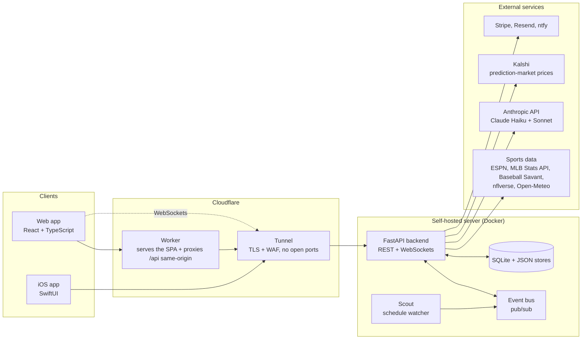
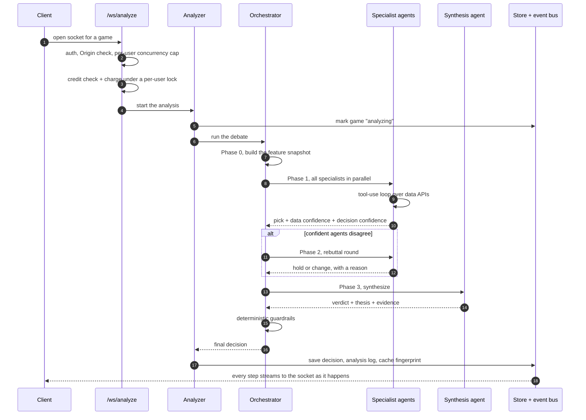
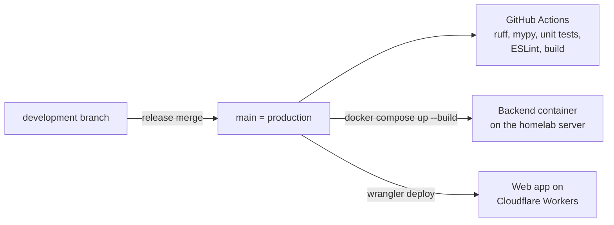

# Architecture

How Sports-Better fits together: where requests go, how an analysis moves through the system, and how it's deployed.

## System overview

- **Clients.** The React web app is static files on Cloudflare Workers. The iOS app is a native SwiftUI client, not a web view, and talks to the same backend.
- **Edge.** The Worker serves the app and proxies `/api/*` requests on the same origin, which removed a class of cross-origin failures (see [ENGINEERING.md](ENGINEERING.md#8-load-failed-on-signup-for-some-real-users)). WebSockets connect straight through the tunnel.
- **Backend.** One FastAPI process with async I/O throughout. Long-running work (agent tool loops, external API calls) is `async`; blocking work (password hashing, Stripe calls) is pushed onto worker threads.
- **Storage.** SQLite in WAL mode holds the usage ledger and the full analysis history, which doubles as the calibration dataset. Smaller config-like stores are JSON files written atomically.

## The analysis pipeline

What happens when a user asks for a full ("Deep") analysis:

Every event in the run goes three places: it's appended to the game's stored feed, published on the event bus, and sent to the requesting socket. That's why a user who reconnects, or opens the same game later, can replay the whole debate without paying for it again.

## Live feeds

| Socket | Purpose |
|---|---|
| `/ws/analyze/{league}/{game_id}` | Streams one analysis: status, each agent's report, rebuttals, the final decision and the market review. |
| `/ws/live` | App-wide feed: new analyses, cache updates, pipeline progress. Filtered per user so you only see games you have access to. |
| `/ws/play-by-play/{league}/{game_id}` | Live game updates, with an HTTP polling fallback when the socket drops. |

The web client reconnects with jittered exponential backoff. On the server, each socket's cleanup is in a `finally` block, so a disconnect can never leak a connection slot or an event-bus subscription.

## The Scout

A background watcher polls league schedules on an interval, diffs them against games it has already seen, and queues analyses for new games under a concurrency cap. Background analyses that would spend API money have a hard kill switch, and the MLB pre-screen skips the full agent pipeline when the win model and the market price are already within 3 points of each other.

## Data sources

All game data comes from free sources without restrictive quotas, so a busy slate can't run into a rate limit or a bill:

- **ESPN** public endpoints: scoreboards, standings, schedules, rosters, injuries
- **MLB Stats API**: probable pitchers, lineups, game logs, splits, live feeds
- **Baseball Savant** (Statcast): batted-ball and pitch-level context
- **nflverse**: weekly EPA-per-play for the NFL model
- **Open-Meteo**: venue weather, wind and precipitation
- **Kalshi**: public prediction-market prices, de-vigged before any comparison

## Deployment

- Work happens on `development`; `main` is production. Nothing deploys automatically, so each release is a deliberate step.
- The backend is rebuilt and restarted with Docker Compose; the production data lives on a mounted volume, so rebuilds don't touch it.
- The web app is built and deployed to Cloudflare Workers separately.
- The server has no open inbound ports. All traffic arrives through the Cloudflare Tunnel.

Owner-only tools that are not part of the public product are left out of this write-up.
